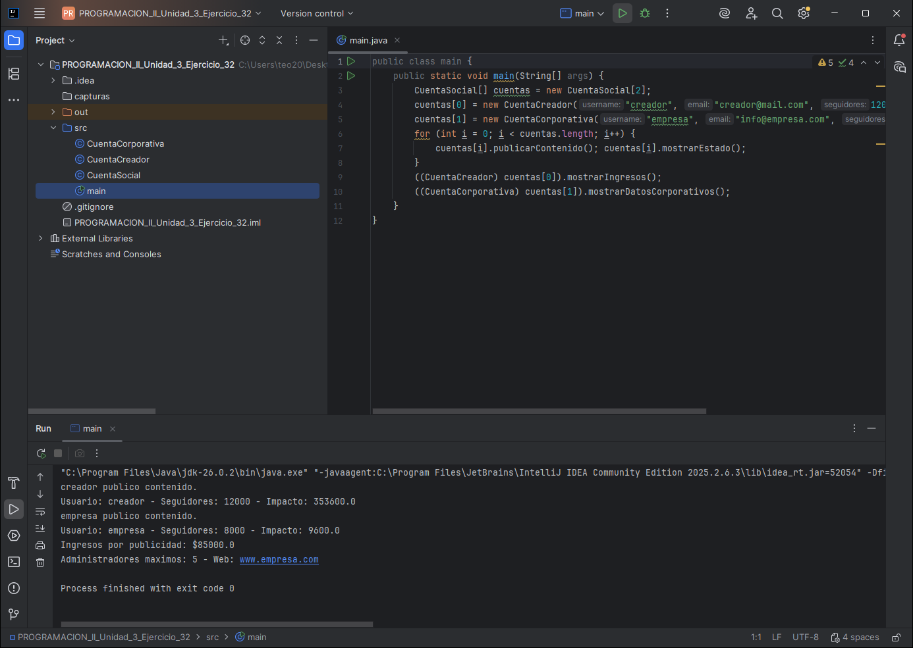

# PROGRAMACIÓN II — Unidad 3, Ejercicio 32: Sistema de Gestión de Cuentas en Redes Sociales

Trabajo práctico de Programación II. Este repositorio contiene la resolución en Java del ejercicio 32 de la Unidad 3.

## Consigna

#### Contexto

Las plataformas digitales multiplataforma administran perfiles de usuario que comparten datos fundamentales como nombre de usuario, correo electrónico y fecha de alta. Sin embargo, las cuentas de creadores de contenido, las cuentas corporativas empresariales y los perfiles verificados de figuras públicas poseen privilegios y métricas de monetización completamente heterogéneas.

#### Consigna

Diseñar una jerarquía de clases en Java utilizando herencia para estructurar una cuenta de usuario base y sus variantes especializadas dentro de una red social.

#### Desarrollo requerido

- Definir la clase base CuentaSocial con atributos privados o protegidos (username, email, seguidores) y métodos comunes como publicar contenido o seguir a otros usuarios.
- Crear las clases hijas CuentaCreador (que incorpore atributos de ingresos por publicidad y visualizaciones) y CuentaCorporativa (que añada un límite de administradores y enlace al sitio web oficial).
- Sobrescribir un método de cálculo de alcance o impacto en las subclases aplicando las reglas particulares de cada tipo de perfil.
- En el método main, instanciar ambos tipos de cuentas especializadas, simular interacciones de publicación y mostrar el estado de las métricas por consola.

## Estructura del repositorio

```
PROGRAMACION_II_Unidad_3_Ejercicio_32/
├── README.md
├── capturas/
│   └── consola.png
└── src/
    ├── CuentaCorporativa.java
    ├── CuentaCreador.java
    ├── CuentaSocial.java
    └── main.java   # clase con el método main
```

## Funcionamiento y lógica

El ejercicio aplica **herencia, polimorfismo y casteo** con distintos tipos de cuentas de una red social.

### `CuentaSocial` (clase base)

Tiene `username`, `email` y `seguidores` (`protected`).

- **`publicarContenido()`:** muestra que el usuario publicó.
- **`seguirUsuario()`:** suma un seguidor.
- **`calcularImpacto()`:** en la clase base devuelve la cantidad de seguidores.
- **`mostrarEstado()`:** imprime usuario, seguidores e impacto.

### `CuentaCreador`

Agrega ingresos por publicidad y visualizaciones. Sobrescribe `calcularImpacto()` como `visualizaciones × 0.7 + seguidores × 0.3`. Tiene el método propio `mostrarIngresos()`.

### `CuentaCorporativa`

Agrega el límite de administradores y el sitio web. Su impacto es `seguidores × 1.2`, y tiene el método propio `mostrarDatosCorporativos()`.

### `main`

Crea un arreglo `CuentaSocial[]` con una cuenta de creador y una corporativa. Al recorrerlo, cada cuenta publica y muestra su estado con su propio cálculo de impacto:

- Creador → **353600**.
- Empresa → **9600**.

Como `mostrarIngresos()` y `mostrarDatosCorporativos()` no existen en la clase base, para llamarlos se **castea** cada elemento a su tipo real, por ejemplo `((CuentaCreador) cuentas[0])`.

## Ejecución

Captura de la consola de IntelliJ IDEA ejecutando el programa:



Salida obtenida:

```
creador publico contenido.
Usuario: creador - Seguidores: 12000 - Impacto: 353600.0
empresa publico contenido.
Usuario: empresa - Seguidores: 8000 - Impacto: 9600.0
Ingresos por publicidad: $85000.0
Administradores maximos: 5 - Web: www.empresa.com
```
